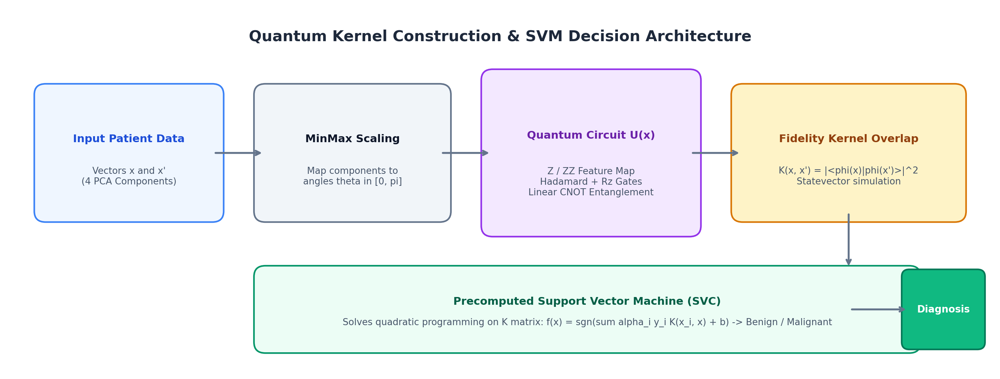
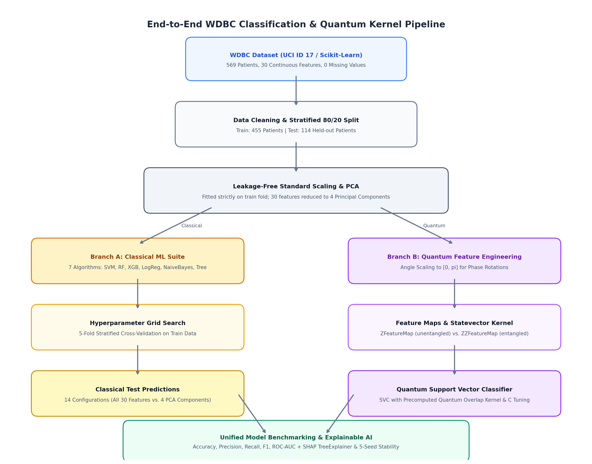

# 🧬 Breast Cancer Diagnosis: Classical vs. Quantum-Kernel Support Vector Machines (QSVM)

[](https://www.python.org/downloads/)
[](https://qiskit.org/)
[](https://scikit-learn.org/)
[](LICENSE)
[]()

> An end-to-end comparative study evaluating **Quantum Support Vector Classifiers (QSVM)** against **7 classical machine learning algorithms** on the Wisconsin Diagnostic Breast Cancer (WDBC) dataset. This project implements statevector fidelity kernels, investigates circuit architectures (depth, entanglement, qubit widths), evaluates statistical stability across random seeds, and provides explainability through SHAP and margin-boundary auditing.

---

## 📑 Table of Contents

- [🎯 1. Problem Statement & Motivation](#-1-problem-statement--motivation)
- [🧠 2. Core Concepts & Quantum Kernel Mechanics](#-2-core-concepts--quantum-kernel-mechanics)
  - [Quantum Kernel Architecture Flowchart](#quantum-kernel-architecture-flowchart)
- [🏗️ 3. End-to-End System Architecture](#️-3-end-to-end-system-architecture)
  - [System Flowchart](#system-flowchart)
  - [Step 1: Data Ingestion & Exploratory Analysis](#step-1-data-ingestion--exploratory-analysis)
  - [Step 2: Leakage-Free Preprocessing](#step-2-leakage-free-preprocessing)
  - [Step 3: Dimensionality Reduction & Angle Mapping](#step-3-dimensionality-reduction--angle-mapping)
  - [Step 4: Classical Baseline Suite](#step-4-classical-baseline-suite)
  - [Step 5: Quantum Feature Mapping & Kernel Estimation](#step-5-quantum-feature-mapping--kernel-estimation)
  - [Step 6: QSVM Training & Optimization](#step-6-qsvm-training--optimization)
  - [Step 7: Ablation, Sensitivity & Stability Studies](#step-7-ablation-sensitivity--stability-studies)
  - [Step 8: Explainable AI (SHAP) & Error Auditing](#step-8-explainable-ai-shap--error-auditing)
- [📊 4. Experimental Results & Benchmarks](#-4-experimental-results--benchmarks)
- [📈 5. Visualizations & Visual Evidence](#-5-visualizations--visual-evidence)
- [🔬 6. Scientific Insights & Quantum Advantage Discussion](#-6-scientific-insights--quantum-advantage-discussion)
- [📂 7. Repository Structure](#-7-repository-structure)
- [🚀 8. Quickstart & Installation](#-8-quickstart--installation)
- [⚠️ 9. Limitations & Ethical Considerations](#️-9-limitations--ethical-considerations)
- [📚 10. References](#-10-references)

---

## 🎯 1. Problem Statement & Motivation

### The Clinical Problem
Breast cancer remains one of the primary causes of oncology-related deaths worldwide. Accurate early diagnosis from **Fine Needle Aspirate (FNA)** biopsy samples is critical. In automated clinical diagnostics, classification errors carry asymmetric real-world consequences:
- **False Positive (Benign classified as Malignant):** Causes acute psychological distress, unnecessary secondary interventions, and clinical workload burdens.
- **False Negative (Malignant classified as Benign):** **Critically dangerous.** Cancer remains undetected and untreated, permitting metastatic progression and avoidable mortality.

Therefore, diagnostic models must prioritize **Malignant Recall (Sensitivity)** and balanced **F1-Score** rather than raw accuracy alone.

### The Research Question
Can emerging **Quantum Machine Learning (QML)** techniques—specifically **Quantum Kernel Methods**—provide competitive or superior decision boundaries compared to state-of-the-art classical models on real-world medical data?

This project investigates:
1. Whether mapping patient features into quantum Hilbert spaces offers natural separation of complex biological boundaries.
2. How circuit parameters (qubit count, repetition depth, entanglement topologies) influence classification efficacy.
3. Whether quantum models exhibit genuine quantum advantage or practical parity against optimized classical baselines.

---

## 🧠 2. Core Concepts & Quantum Kernel Mechanics

In classical Support Vector Machines (SVMs), the **Kernel Trick** calculates inner products in a higher-dimensional feature space without explicitly calculating coordinates in that space. A **Quantum Kernel** generalizes this idea into an exponentially large quantum Hilbert space.

### Quantum Kernel Architecture Flowchart



### Simple Explanations of Key Terms:
* **Support Vector Machine (SVM):** Finds the widest possible safety margin (decision boundary) between two classes of data.
* **Kernel Trick:** When data points cannot be separated with a straight line, a kernel computes pairwise similarity in a higher-dimensional space where separation becomes linear.
* **Quantum Feature Map:** Converts numeric data into quantum states ($|\phi(\mathbf{x})\rangle$) using quantum logic gates (Hadamard, Phase Rotations, CNOTs).
* **Quantum Kernel:** Calculates the quantum fidelity (squared inner product) between two quantum states: $K(\mathbf{x}_i, \mathbf{x}_j) = |\langle \phi(\mathbf{x}_i) | \phi(\mathbf{x}_j) \rangle|^2$. A score of `1.0` means identical quantum states; `0.0` means completely orthogonal.
* **Precomputed QSVM:** A classical SVM that skips standard formulas (like RBF or Linear kernels) and directly consumes the quantum similarity matrix generated via quantum simulation.

---

## 🏗️ 3. End-to-End System Architecture

### System Pipeline Flowchart



---

### Step 1: Data Ingestion & Exploratory Analysis
- **Dataset:** Wisconsin Diagnostic Breast Cancer (WDBC) containing **569 patients** with **30 continuous numeric features** derived from cell nucleus imaging.
- **Fallback Ingestion:** Automatically attempts download from UCI Repository (ID 17); falls back cleanly to Scikit-learn's bundled WDBC dataset if offline.
- **Integrity:** Confirmed zero missing, null, or corrupted values. ID columns dropped. Target converted: `0 = Benign` (357 patients), `1 = Malignant` (212 patients).

| Class Distribution | Correlation Heatmap (Multicollinearity) |
| :---: | :---: |
|  |  |

| Feature Boxplots by Diagnosis |
| :---: |
|  |

---

### Step 2: Leakage-Free Preprocessing
- **Stratified Split:** 80% Training (455 patients: 285 Benign, 170 Malignant) and 20% Testing (114 patients: 72 Benign, 42 Malignant).
- **Leakage Prevention:** `StandardScaler` is fitted **strictly on the training split**. Test data is transformed using the training mean and standard deviation alone, eliminating information leakage.

---

### Step 3: Dimensionality Reduction & Angle Mapping
- **Simulator Constraint:** Statevector simulation of $N$ qubits on classical computers requires computing $2^N$ complex amplitudes. Simulating all 30 features as 30 qubits is computationally infeasible.
- **PCA Reduction:** PCA reduces the 30 collinear measurements to **4 principal components**, preserving key structural variance.
- **Angle Normalization:** Features are mapped into rotation angles $\theta \in [0, \pi]$ using `MinMaxScaler` for single-qubit phase rotations ($R_z(\theta)$).

| Cumulative PCA Explained Variance |
| :---: |
|  |

---

### Step 4: Classical Baseline Suite
To establish benchmark baselines, **7 classical algorithms** were tuned via 5-fold stratified cross-validation across **two distinct regimes**:
1. **Regime A (All 30 Features):** Full biological measurement space.
2. **Regime B (4 PCA Components):** Dimension-matched to the quantum simulator for fair comparison.

Models evaluated: **Logistic Regression**, **Decision Tree**, **Random Forest**, **Gaussian Naive Bayes**, **XGBoost**, **Linear SVM**, and **RBF SVM**.

---

### Step 5: Quantum Feature Mapping & Kernel Estimation
We implemented two contrasting quantum feature maps via **Qiskit Machine Learning**:
- **`ZFeatureMap` (Unentangled):** Applies single-qubit Hadamard ($H$) and Phase rotation ($R_z$) gates. Qubits evolve independently without entanglement.
- **`ZZFeatureMap` (Entangled):** Adds CNOT gates creating two-qubit entangling gates ($R_{zz}$) that encode pairwise feature interactions: $\phi_{\{i,j\}}(\mathbf{x}) = 2(\pi - x_i)(\pi - x_j)$.

| ZFeatureMap (4 Qubits, 2 Reps) | ZZFeatureMap (4 Qubits, 2 Reps, Linear) |
| :---: | :---: |
|  |  |
| **Z Kernel Similarity Heatmap** | **ZZ Kernel Similarity Heatmap** |
|  |  |

*The heatmaps show fidelity overlap values. The bright diagonal ($1.0$) confirms each patient's quantum state is identical to itself.*

---

### Step 6: QSVM Training & Optimization
- Precomputed kernel matrices ($K_{\text{train}}, K_{\text{test}}$) are passed to `SVC(kernel="precomputed")`.
- Regularization parameter $C \in [0.1, 1, 10, 100]$ is optimized using 5-fold stratified cross-validation on the training kernel.

| Z-QSVM Confusion Matrix | ZZ-QSVM Confusion Matrix |
| :---: | :---: |
|  |  |

*Notice that Z-QSVM misses 10 malignant cases, while ZZ-QSVM misses 21 malignant cases.*

---

### Step 7: Ablation, Sensitivity & Stability Studies

To understand how quantum circuit design affects performance, we conducted several ablation experiments:

#### 1. Repetition Depth & Entanglement Topology
| Circuit Repetitions (ZZ Map) | Entanglement Topologies |
| :---: | :---: |
|  |  |

#### 2. Qubit Width Scaling & Quantum vs. Classical RBF
| Qubit Width Scaling (4 vs 6 vs 8 Qubits) | QSVM vs. Classical RBF (4 PCA) |
| :---: | :---: |
|  |  |

#### 3. 5-Seed Multi-Split Stability Analysis
We cross-evaluated the top models across 5 random seeds (42, 7, 21, 84, 123) to verify statistical consistency:

| 5-Seed F1 Stability (Mean ± Std Dev) | Feature Map Comparison (Z vs ZZ) |
| :---: | :---: |
|  |  |

---

### Step 8: Explainable AI (SHAP) & Error Auditing
- **SHAP Summary:** TreeExplainer on XGBoost reveals that `worst concave points`, `mean concave points`, and `worst perimeter` are the strongest drivers pushing predictions toward malignancy.
- **Margin Distance Auditing:** Evaluated signed decision boundary margins ($f(\mathbf{x}) = \mathbf{w}^T \phi(\mathbf{x}) + b$) for all misclassified test cases. Patients with scores close to zero (e.g., Row 205 with score -0.004) were right on the decision boundary.

| XGBoost SHAP Summary Plot |
| :---: |
|  |

---

## 📊 4. Experimental Results & Benchmarks

All models were evaluated on the held-out 114 test patients (72 Benign, 42 Malignant). Ranked by **Malignant Recall**, then **F1-Score**:

| Rank | Model | Feature Space | Accuracy | Precision | Malignant Recall | F1-Score | ROC-AUC | Training Time |
| :---: | :--- | :--- | :---: | :---: | :---: | :---: | :---: | :---: |
| 🥇 | **SVM (Linear)** | **All 30 features** | **0.982** | **1.000** | **0.952** | **0.976** | **0.996** | 0.15 s |
| 🥈 | **Random Forest** | **All 30 features** | **0.974** | **1.000** | **0.929** | **0.963** | **0.993** | 1.84 s |
| 🥉 | **SVM (RBF)** | **All 30 features** | **0.974** | **1.000** | **0.929** | **0.963** | **0.993** | 0.14 s |
| 4 | **Logistic Regression** | PCA 4 components | 0.974 | 1.000 | 0.929 | 0.963 | 0.998 | 0.17 s |
| 5 | **SVM (Linear)** | PCA 4 components | 0.974 | 1.000 | 0.929 | 0.963 | 0.998 | 0.12 s |
| 6 | **Logistic Regression** | All 30 features | 0.965 | 0.975 | 0.929 | 0.951 | 0.996 | 0.19 s |
| 7 | **XGBoost** | All 30 features | 0.965 | 1.000 | 0.905 | 0.950 | 0.994 | 1.19 s |
| 8 | **Random Forest** | PCA 4 components | 0.956 | 0.974 | 0.905 | 0.938 | 0.994 | 1.55 s |
| 9 | **SVM (RBF)** | PCA 4 components | 0.947 | 0.974 | 0.881 | 0.925 | 0.997 | 0.16 s |
| 10 | **Decision Tree** | PCA 4 components | 0.939 | 0.949 | 0.881 | 0.914 | 0.927 | 0.15 s |
| 11 | **XGBoost** | PCA 4 components | 0.939 | 0.973 | 0.857 | 0.911 | 0.992 | 0.51 s |
| 12 | **Decision Tree** | All 30 features | 0.930 | 0.905 | 0.905 | 0.905 | 0.925 | 0.19 s |
| 13 | **Naive Bayes** | All 30 features | 0.921 | 0.923 | 0.857 | 0.889 | 0.989 | 0.10 s |
| 14 | **Naive Bayes** | PCA 4 components | 0.904 | 0.919 | 0.810 | 0.861 | 0.981 | 0.14 s |
| 15 | **QSVM (ZFeatureMap)** | **4 PCA (50 train)** | **0.895** | **0.941** | **0.762** | **0.842** | **0.977** | 55.19 s |
| 16 | **QSVM (ZZFeatureMap)** | **4 PCA (50 train)** | **0.737** | **0.700** | **0.500** | **0.583** | **0.784** | 74.27 s |

### 5-Seed Multi-Split Stability Summary ($\mu \pm \sigma$)

| Model Architecture | Accuracy ($\mu \pm \sigma$) | Malignant Recall ($\mu \pm \sigma$) | F1-Score ($\mu \pm \sigma$) | ROC-AUC ($\mu \pm \sigma$) |
| :--- | :---: | :---: | :---: | :---: |
| **Linear SVM (All 30 Features)** | **0.970 ± 0.015** | **0.943 ± 0.036** | **0.959 ± 0.021** | **0.994 ± 0.005** |
| **RBF SVM (PCA 4 Components)** | 0.946 ± 0.011 | 0.905 ± 0.038 | 0.925 ± 0.016 | 0.989 ± 0.007 |
| **QSVM (ZFeatureMap)** | 0.907 ± 0.021 | 0.848 ± 0.069 | 0.870 ± 0.032 | 0.959 ± 0.021 |
| **QSVM (ZZFeatureMap)** | 0.681 ± 0.033 | 0.476 ± 0.061 | 0.523 ± 0.047 | 0.700 ± 0.053 |

---

## 📈 5. Visualizations & Visual Evidence

| Overall F1 Model Comparison | ROC Curves (All Competitors) |
| :---: | :---: |
|  |  |

| Complete Model Performance Matrix |
| :---: |
|  |

---

## 🔬 6. Scientific Insights & Quantum Advantage Discussion

### 1. Does Quantum Advantage Exist for WDBC?
**No.** Classical models demonstrably outperformed simulated quantum kernels:
- Classical Linear SVM achieved **95.2% recall** and **97.6% F1** in **0.15 seconds**.
- Best QSVM (ZFeatureMap) achieved **76.2% recall** and **84.2% F1** in **55.19 seconds**.

### 2. Why Did ZFeatureMap Outperform ZZFeatureMap?
Adding quantum entanglement through ZZ gates resulted in performance degradation (F1 dropped from 0.842 to 0.583).
- **Over-rotation & Feature Scattering:** In small-sample regimes ($N=50$), pairwise phase entangling gates ($R_{zz}$) scatter data points excessively across Hilbert space ($2^4 = 16$).
- **Kernel Diagonal Flattening:** Off-diagonal kernel values drop close to zero, preventing the classical SVM from discovering a coherent separating hyperplane.

### 3. The "Curse of Dimensionality" in QML
In our width-scaling experiment (4 vs. 6 vs. 8 qubits with $N=25$ patients):
- At 6 and 8 qubits, the models **completely collapsed**, predicting zero malignant cases (Recall = 0.0, F1 = 0.0).
- As qubit count increases, Hilbert space volume scales as $2^N$. Without an exponential increase in training samples, quantum states become mutually orthogonal, leading to a quantum analog of the curse of dimensionality.

---

## 📂 7. Repository Structure

```
wdbc-qsvm/
├── README.md                              # Main professional project documentation
├── PROCEDURE.md                           # Detailed cell-by-cell execution & viva guide
├── EXPLAIN.md                             # Plain-English conceptual explanation
├── report.md                              # Formal summary report with tables
├── helpers.py                             # Reusable metric scoring & plotting utilities
├── requirements.txt                       # Locked Python dependencies
├── wdbc_qsvm_notebook.ipynb               # The master Jupyter research notebook
│
└── results/                               # Generated artifacts, tables, and charts
    ├── final_comparison.csv               # Master benchmark table (all 16 models)
    ├── stability_summary.csv              # 5-seed mean & std deviation results
    ├── shap_feature_importance.csv        # SHAP feature contributions
    ├── pca_loadings_top_features.csv      # Top feature loadings on principal components
    ├── qsvm_misclassified_test_patients.csv# Error audit table for difficult test cases
    ├── package_versions.csv               # Software environment snapshot
    │
    ├── *.png                              # 17 high-resolution publication charts
    └── kernels/                           # Cached quantum kernel matrices (.npz)
        ├── Z_4q_reps2_none_seed42.npz
        ├── ZZ_4q_reps2_linear_seed42.npz
        └── stability_*.npz
```

---

## 🚀 8. Quickstart & Installation

### Prerequisites
- Python 3.10, 3.11, or 3.12
- 64-bit OS (Windows, macOS, or Linux)
- Minimum 8 GB RAM recommended

### Setup Instructions

```powershell
# 1. Clone the repository and navigate into the folder
cd d:\quantumgroup\wdbc-qsvm

# 2. Create and activate a clean virtual environment
python -m venv .venv
.\.venv\Scripts\Activate.ps1    # On Linux/macOS: source .venv/bin/activate

# 3. Upgrade pip and install pinned requirements
python -m pip install --upgrade pip
python -m pip install -r requirements.txt

# 4. Register the kernel for Jupyter
python -m ipykernel install --user --name wdbc-qsvm --display-name "Python (wdbc-qsvm)"

# 5. Launch Jupyter Lab or Notebook
jupyter lab wdbc_qsvm_notebook.ipynb
```

In JupyterLab, select the **`Python (wdbc-qsvm)`** kernel and click **Run → Run All Cells**. Precomputed kernels are cached in `results/kernels/`, allowing the full notebook to run cleanly without recomputing long simulations.

---

## ⚠️ 9. Limitations & Ethical Considerations

- **Non-Clinical Research:** This software is an academic demonstration comparing machine learning paradigms. It is **not** certified as medical software or clinical diagnostic aid.
- **Simulation vs. Real QPU:** All quantum operations were executed via statevector numerical simulation (`qiskit-aer`). Real Quantum Processing Units (QPUs) suffer from physical noise, decoherence, and measurement shot error not modeled here.
- **Asymmetric Sample Sizes:** Due to statevector simulation costs, quantum kernels trained on $N=50$ patients, while classical baselines utilized the full $N=455$ training split.

---

## 📚 10. References

1. **Islam, T., et al. (2024).** *Predictive Modeling for Breast Cancer Classification in the Context of Bangladeshi Patients: A Supervised Machine Learning Approach with Explainable AI.* [arXiv:2404.04686](https://arxiv.org/abs/2404.04686).
2. **Havlíček, V., et al. (2019).** *Supervised learning with quantum-enhanced feature spaces.* Nature, 567(7747), 209–212. [doi:10.1038/s41586-019-0980-2](https://doi.org/10.1038/s41586-019-0980-2).
3. **Wolberg, W., Street, N., & Mangasarian, O. (1995).** *Breast Cancer Wisconsin (Diagnostic) Data Set.* UCI Machine Learning Repository. [Dataset ID 17](https://archive.ics.uci.edu/dataset/17/breast+cancer+wisconsin+diagnostic).
4. **Qiskit Machine Learning Community.** *Quantum Kernels & Feature Maps Documentation.* [qiskit-community.github.io/qiskit-machine-learning](https://qiskit-community.github.io/qiskit-machine-learning/).
5. **Lundberg, S. M., & Lee, S.-I. (2017).** *A Unified Approach to Interpreting Model Predictions (SHAP).* Advances in Neural Information Processing Systems 30 (NeurIPS 2017).
